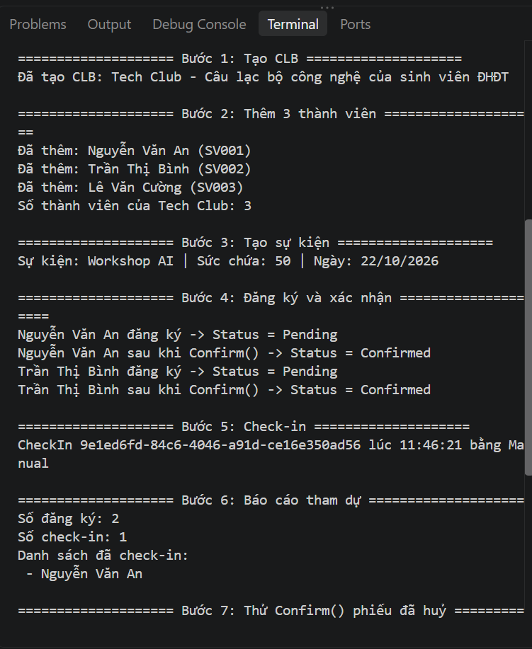

# EduHub - Ch01: Phân tích yêu cầu và Domain Modeling

Sinh viên: <Phạm Chí Thiện> - MSSV: 0024417997
Môn: IN4211 - Phát triển phần mềm hướng đối tượng

## Thiết kế domain

EduHub quản lý Câu lạc bộ và Sự kiện sinh viên, gồm 5 class:

| Class | Vai trò |
|---|---|
| Member | Thành viên sinh viên (Id, Name, Email, StudentCode, JoinedAt) |
| Club | Câu lạc bộ, chứa danh sách Member |
| Event | Sự kiện thuộc 1 Club (FK: ClubId) |
| Registration | Phiếu đăng ký, nối Member và Event (FK: MemberId, EventId) |
| CheckIn | Điểm danh, thuộc 1 Registration (FK: RegistrationId) |

Quan hệ: Club * -- * Member; Club 1 - * Event; Event 1 - * Registration; Member 1 - * Registration; Registration 1 - 0..1 CheckIn.

Nguyên tắc thiết kế: constructor private, tạo đối tượng qua `Create(...)` có kiểm tra dữ liệu, property `private set`, trạng thái dùng enum (`RegistrationStatus`, `CheckInMethod`).

Chi tiết: [docs/user-stories.md](docs/user-stories.md), [docs/class-diagram.md](docs/class-diagram.md).

## Cách chạy

Yêu cầu: .NET 10 SDK.

```bash
cd EduHub.Ch01
dotnet run
```

## Kết quả chạy

